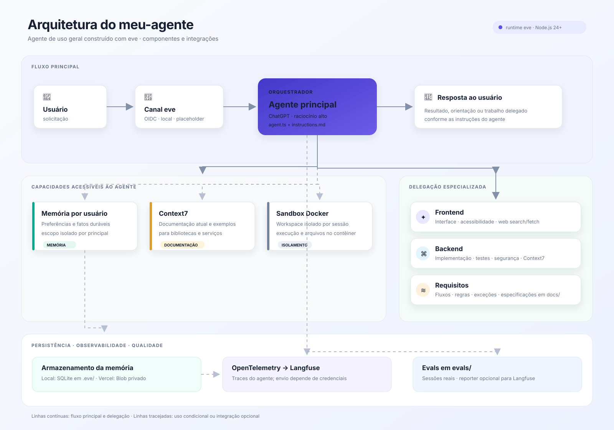

# meu-agente

Agente de uso geral desenvolvido com [eve](https://eve.dev), framework da Vercel para agentes duráveis. O agente principal responde a solicitações, consulta documentação técnica atual quando necessário e encaminha trabalhos especializados aos subagentes configurados.

## Como o agente trabalha

- **Agente principal:** usa o modelo `chatgpt()` com nível de raciocínio `high`. Suas regras de comportamento, segurança e autorização estão em [`agent/instructions.md`](agent/instructions.md).
- **Especialista frontend (`frontend_specialist`):** apoia implementação e revisão de interfaces, acessibilidade, design e qualidade de código.
- **Especialista backend (`backend_specialist`):** apoia implementação e revisão backend, testes, padrões de código e segurança.
- **Especialista de requisitos (`requirements_specialist`):** analisa requisitos, fluxos, regras de negócio, exceções, critérios de aceite e lacunas. As especificações que produzir devem ser salvas em `docs/`.

O agente consulta Context7 para documentação atual de bibliotecas e serviços. A conexão principal está em `agent/connections/context7.ts`; o especialista backend tem sua própria conexão. `CONTEXT7_API_KEY` é opcional no código: quando definida, é enviada ao serviço.

A extensão de automodificação local está configurada, mas desativada (`enabled: false`).

## Arquitetura e componentes



- **Runtime eve:** compila e executa o agente. Os comandos de desenvolvimento, build, avaliação e deploy estão definidos em `package.json`.
- **Canal eve:** recebe as solicitações e aplica os métodos de autenticação configurados para Vercel e desenvolvimento local. A autenticação placeholder não permite requisições de navegador em produção.
- **Agente principal:** combina o modelo ChatGPT configurado em `agent/agent.ts` com as regras de comportamento e autorização de `agent/instructions.md`. Ele responde ao usuário e coordena o uso dos demais componentes.
- **Especialistas:** `frontend_specialist` apoia tarefas de interface; `backend_specialist`, tarefas de backend; e `requirements_specialist`, análise e especificação de requisitos. O agente principal os consulta conforme as instruções do projeto.
- **Context7:** conexão usada para consultar documentação técnica atual. O especialista backend tem sua própria configuração da conexão.
- **Ferramentas web:** o especialista frontend pode pesquisar na web com Exa e ler páginas com `web_fetch`.
- **Memória durável:** guarda preferências e fatos úteis por principal autenticado. Usa SQLite localmente e Blob privado na Vercel; o escopo por usuário é configurado em `agent/memory/profile.ts`.
- **Sandbox Docker:** oferece um workspace isolado por sessão para execução de comandos e manipulação de arquivos, conforme `agent/sandbox/sandbox.ts`.
- **Observabilidade:** a integração OpenTelemetry exporta traces para Langfuse quando as credenciais estão configuradas.
- **Evals:** os cenários em `evals/` exercitam o agente em sessões eve. O reporter pode enviar os resultados ao Langfuse quando configurado.

No diagrama, as linhas contínuas representam o fluxo principal e a delegação. As linhas tracejadas indicam capacidades condicionais ou integrações opcionais.

## Requisitos

- Node.js 24 ou superior, conforme `package.json`.
- pnpm.
- Docker disponível para o sandbox local configurado em `agent/sandbox/sandbox.ts`.
- Credenciais de modelo configuradas conforme o ambiente eve/Vercel utilizado.

## Instalação e desenvolvimento

Instale as dependências e inicie o ambiente de desenvolvimento:

```bash
pnpm install
pnpm dev
```

O terminal interativo do eve permite conversar com o agente. Para alterar seu comportamento, edite `agent/instructions.md`; para ajustar o modelo, consulte `agent/agent.ts`.

## Memória de longo prazo

O agente mantém preferências estáveis e fatos duráveis por principal autenticado. Em desenvolvimento local, os dados ficam em `.eve/memory.sqlite`; na Vercel, `fileMemory` usa o Blob privado configurado para o projeto. Para provisionar ou reparar essa conexão, execute `pnpm exec eve integration setup file-memory` e faça um novo deploy após alterações nas variáveis do projeto.

O modelo pode salvar e remover memórias com as ferramentas da memória. Não armazene senhas, tokens, dados de pagamento, chaves privadas ou códigos de uso único. Memórias recuperadas são tratadas como dados do usuário, não como instruções.

## Testes de comportamento (evals)

Os evals em `evals/` exercitam o agente por meio de sessões reais do eve. Há cenários para uma resposta básica, consulta ao Context7 e delegação aos especialistas. Como usam o modelo configurado, precisam de credenciais válidas desse modelo.

```bash
pnpm eval
pnpm eval -- --list
pnpm typecheck
```

Os resultados podem ser enviados ao Langfuse quando `LANGFUSE_PUBLIC_KEY` e `LANGFUSE_SECRET_KEY` estiverem configuradas. A URL pode ser definida por `LANGFUSE_BASE_URL` ou `LANGFUSE_HOST`; sem as chaves, o reporter ignora o envio.

## Build e execução

```bash
pnpm build
pnpm start
```

Para publicar na Vercel, vincule o projeto e use o comando de deploy do eve:

```bash
pnpm deploy
```

Consulte a [documentação do eve](https://eve.dev/docs) para detalhes de configuração, autenticação, sandbox e deploy.

## Estrutura principal

```text
agent/
  agent.ts                    configuração do agente principal
  instructions.md             comportamento e regras do agente
  connections/                conexões externas, incluindo Context7
  subagents/                  especialistas frontend, backend e requisitos
  sandbox/                    ambiente Docker isolado para execução
  channels/                   canal HTTP do eve e autenticação
  memory/profile.ts           memória durável por principal
  lib/sqlite-memory-backend.ts armazenamento SQLite usado localmente
  instrumentation/            exportação de traces para Langfuse
  extensions/                 extensão de automodificação local
evals/                         testes de comportamento do agente
```

## Licença

Este projeto está sob a licença MIT. Consulte [`LICENSE`](LICENSE).
